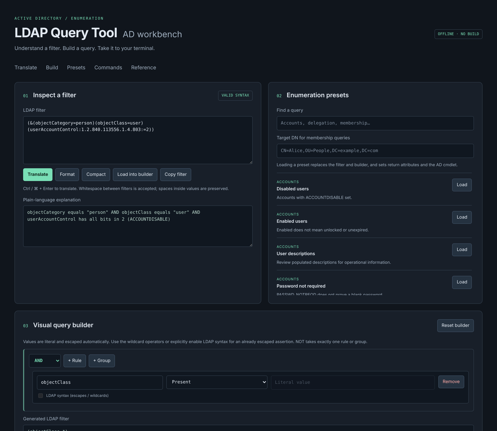

# LDAP Query Tool

A simple, lightweight, zero-build web interface to translate and construct LDAP queries.

## Features

This tool is split into distinct, standalone sections:

1. **LDAP to Human Readable Translation:**
   - Parses standard RFC 4515 LDAP query strings (supporting `&`, `|`, `!`, `=`, `~=`, `>=`, `<=`, and wildcards `*`).
   - Translates complex, deeply nested queries into intuitive, plain-text sentences (e.g., `(&(name=Kaylie)(title=Manager))` becomes `name = Kaylie AND title = Manager`).
   - Understands **extensible matching rule OIDs**: bitwise AND (`1.2.840.113556.1.4.803`), bitwise OR (`1.2.840.113556.1.4.804`) and the recursive "in chain" rule (`1.2.840.113556.1.4.1941`).
   - **Decodes `userAccountControl` bitmasks into named flags** — e.g. `(userAccountControl:1.2.840.113556.1.4.803:=2)` becomes *"userAccountControl has all of these flags: ACCOUNTDISABLE"*.
   - Decodes hex-escaped characters (`\2a`, `\28`, ...) back into readable text.
   - Accepts both the strict (`(!(cn=x))`) and lenient (`(!cn=x)`) forms of the `!` operator.
   - Automatically handles grouping via parentheses to ensure logic remains unambiguous.
   - A **preset menu** loads well-known administration / enumeration filters (disabled accounts, accounts not requiring a password, SPN-holding users, `adminCount=1`, recursive group membership, and more).

2. **Visual Query Builder:**
   - Provides an infinitely chainable UI to create complex LDAP queries without needing to know the syntax.
   - Users can nest logical groups (AND, OR, NOT) and add multiple rules (Fields, Operators, Values) to each group.
   - Operators include equality, approximate (`~=`), range (`>=`, `<=`), substring/wildcard, presence, and the **bitwise / in-chain extensible matches**.
   - **Automatically escapes** `*`, `(`, `)`, `\` and NUL inside values per RFC 4515 (toggleable).
   - **Attribute autocomplete** suggests common Active Directory / LDAP attribute names.
   - Instantly generates valid LDAP query strings based on the visual layout.

3. **Quick Reference:**
   - At-a-glance tables for operators, comparison criteria, matching rule OIDs, escaped characters and search scope levels.

### Copy to clipboard
Both the translated output and the generated query have one-click **Copy** buttons.

## Tech Stack
Built using standard HTML, CSS, and Vanilla JavaScript with no external dependencies or build steps required. Simply open `index.html` in your browser to use the tool!

## Preview

