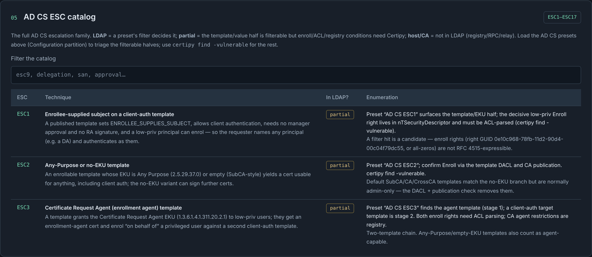
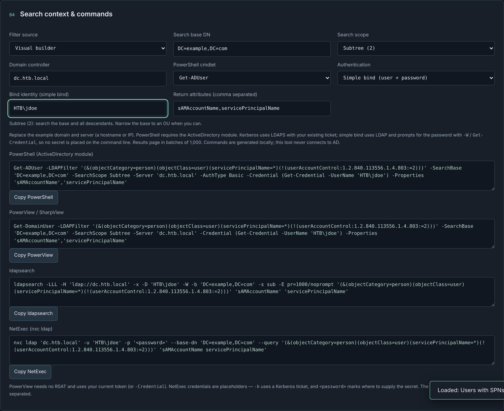

# LDAP Query Tool · AD Workbench

A zero-build, fully-offline web workbench for reading, building and operationalising
RFC 4515 LDAP filters against Active Directory. Aimed at system administration and
authorised red-team / HTB-style AD enumeration: understand a filter, build one
visually, then take a ready-to-run `ldapsearch` / PowerShell command to your terminal.

No dependencies, no build step, no network calls, and no query history is stored —
open `index.html` in a browser and everything runs locally.

## Features

### 1 · Inspect a filter
- Parses standard RFC 4515 filters (`&`, `|`, `!`, `=`, `~=`, `>=`, `<=`, substrings/wildcards)
  with strict validation, helpful position-aware errors, and nesting/length limits.
- Handles **extensible matching rules**, including bitwise AND (`1.2.840.113556.1.4.803`),
  bitwise OR (`1.2.840.113556.1.4.804`) and recursive "in chain" DN matching
  (`1.2.840.113556.1.4.1941`), plus optional `:dn` DN-attribute matching.
- **Decodes `userAccountControl` bitmasks into named flags** (e.g. `...:=2` → `ACCOUNTDISABLE`).
- Decodes hex-escaped values (`\2a`, multi-byte UTF-8, etc.) into readable text.
- **Decodes bitmask attributes into named flags** when matched with a bitwise rule:
  `userAccountControl`, `groupType`, `msDS-SupportedEncryptionTypes`, `trustAttributes`,
  and the AD CS `msPKI-Certificate-Name-Flag` / `msPKI-Enrollment-Flag`. Common **EKU OIDs**
  (Client Authentication, Smart Card Logon, PKINIT, Any Purpose, …) are named in explanations.
- **Diagnostics**: contextual notes that flag common AD gotchas — `objectClass=user`
  also matches computers, `adminCount=1` can be stale, `PASSWD_NOTREQD` ≠ blank password,
  leading-wildcard cost, recursive membership not covering primary groups, and more.
- **Format** (pretty-print) and **Compact** buttons; **Load into builder** for round-tripping.

### 2 · Enumeration presets
- A searchable, categorised library of **51** well-known AD queries distilled from 0xdf /
  HTB ProLabs / VulnLab / CRTO writeups: all/enabled/disabled users,
  password-not-required, never-expiring passwords, must-change-password, protected
  (`adminCount=1`) accounts, **Kerberoastable** (precise `samAccountType`, SPN, MSSQL),
  **AS-REP roastable**, **RC4-roastable** (no AES), **unconstrained / constrained /
  RBCD / protocol-transition delegation**, recursive group membership (target-DN
  parameter), security groups, **LAPS** (legacy + Windows LAPS) and **gMSA**, **shadow
  credentials**, **SID history**, foreign security principals, credential-hunting in
  description/info, GPOs, OUs, PSOs, computers, domain controllers, legacy OSes, and
  trusts.
- Loading a preset fills the filter, the builder, the return attributes, the AD cmdlet
  and (for AD CS) the Configuration-partition search base, with an accurate operational note.

### AD CS ESC catalog (ESC1–ESC17)
- A full reference of the AD CS escalation family, each labelled by how much a plain LDAP
  filter can decide: **LDAP** (filter decides it), **partial** (template/value half is
  filterable; enroll/ACL/registry conditions need Certipy), or **host/CA** (registry / RPC /
  relay — not in the directory).
- Presets for every LDAP-filterable technique and the AD CS object model: enterprise CAs,
  the full template triage set, NTAuthCertificates, CA trust objects, issuance-policy OID
  objects, and **ESC1 / ESC2 / ESC3 / ESC4 / ESC5 / ESC9 / ESC13 / ESC14 / ESC15 / ESC17**.
  The ESC1 filter uses the `0x1 | 0x10000` name-flag `BIT_OR` (catches SAN-only templates)
  and ORs both EKU attributes (`pKIExtendedKeyUsage` + `msPKI-Certificate-Application-Policy`)
  — deliberately broader than Certipy's `0x1`-only check.



### 3 · Visual query builder
- Infinitely nestable AND / OR / NOT groups and rules, with node/depth limits.
- Operators for equality, inequality, approximate, range, substrings, presence/absence
  and extensible (OID) matches.
- Values are **literal and auto-escaped** (`*`, `(`, `)`, `\`, NUL) to prevent filter
  injection, with an explicit "LDAP syntax" toggle for already-escaped assertions.
- Attribute-name autocomplete, and a **userAccountControl bitmask composer**.

### 4 · Search context & commands
- Generates ready-to-run commands from the current filter, with injection-safe quoting, for
  **five toolchains**: **PowerShell** (`Get-ADObject/User/Computer/Group`), **PowerView /
  SharpView** (`Get-Domain*`, no RSAT required), **`ldapsearch`**, **NetExec**
  (`nxc ldap --query`), and **windapsearch** (`--custom`).
- Configurable search base, **search scope** (Base / OneLevel / Subtree), domain
  controller (hostname or IP) and return attributes. The domain is derived from the base DN.
- **Authentication modes for HTB/engagements**: Kerberos (GSSAPI over LDAPS / `-k` with your
  existing ticket) or **simple bind** (over LDAP with a bind identity). Secrets are never
  placed on the command line — `ldapsearch -W` / `Get-Credential` prompt for them, and the
  NetExec/windapsearch password is a `<password>` placeholder.
- When the return attributes include `nTSecurityDescriptor`, the `ldapsearch` line adds the
  **`LDAP_SERVER_SD_FLAGS` control** (owner+DACL) so a non-admin read is not blanked —
  essential for parsing template DACLs (ESC4/ESC5).
- Paged results (`pr=1000`) by default. Commands are generated locally; the tool never
  connects to AD.



### Command recipes
A reference panel of fixed tool invocations that don't consume the builder filter —
`certipy find/req/auth`, `Certify`, `GetUserSPNs`/`GetNPUsers`, `Rubeus`,
`bloodhound-python`, the NetExec `adcs` module, `ldapdomaindump`, and the rootDSE
Configuration-NC discovery step.

### 5 · Reference
- Searchable catalog of 700+ AD attributes (LDAP name, CN, attribute OID), including the
  delegation / trust / AD CS / shadow-credential attributes used above.
- Filter-syntax and matching-rule cheat sheet, a **bitmask/EKU decoder reference**, and a
  standalone value-escaping helper.

## Tech Stack
Plain HTML, CSS and dependency-free JavaScript. The LDAP engine (`ldap.js`) runs in both
the browser and Node, so the logic is unit-tested.

## Tests
```bash
node --test            # ldap.js engine, presets, catalog and command generation
```
A browser-side suite (`tests/browser.js`) exercises the full UI; paste it into the page's
DevTools console, or drive it with a headless browser, and call `runBrowserTests()`.

## Preview


